# AIVista — AI Search Revenue Agent

**An agentic Generative Engine Optimization (GEO) platform.** Give it a company and it investigates how AI assistants
talk about that brand compared with its competitors, explains *why* competitors get recommended instead, and tells you
what to change. It then projects the impact and lets you measure it over time.

**Live app:** https://aivista-0fbq.onrender.com &nbsp;·&nbsp; Runs entirely on free tools and free-tier AI APIs.

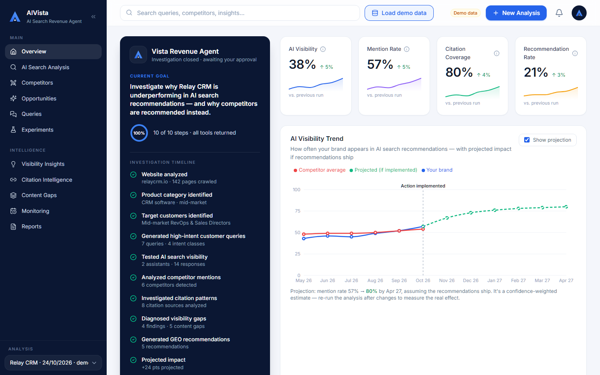

---

## Contents

- [Why AIVista](#why-aivista)
- [How it works (workflow)](#how-it-works-workflow)
- [Screenshots](#screenshots)
- [Features](#features)
- [AI models](#ai-models)
- [How the metrics are computed](#how-the-metrics-are-computed)
- [Architecture](#architecture)
- [Tech stack](#tech-stack)
- [Project structure](#project-structure)
- [Getting started](#getting-started)
- [Environment variables](#environment-variables)
- [API reference](#api-reference)
- [Data model](#data-model)
- [Deployment](#deployment)
- [Scripts](#scripts)
- [Limitations and roadmap](#limitations-and-roadmap)

---

## Why AIVista

Buyers increasingly ask AI assistants things like *"best CRM for startups"* or *"HubSpot alternatives"* instead of
searching Google. If the assistants recommend your competitors, you lose the deal before you know it existed.

AIVista answers three questions:

1. **How visible is my brand in AI answers?** Mention rate, recommendation rate and position versus competitors.
2. **Why do competitors win?** Missing comparison content, weak third-party citations, unclear positioning.
3. **What should I do, and what will it change?** Prioritized GEO recommendations, experiments you approve, and a
   projected visibility trend.

---

## How it works (workflow)

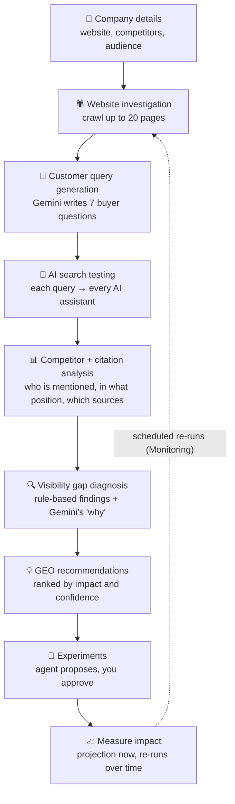

| # | Step | What happens | Where in the code |
|---|---|---|---|
| 1 | **Company details** | You enter the website, brand name, industry, market, audience and competitors in **New Analysis** | `src/components/NewAnalysisModal.tsx` |
| 2 | **Website investigation** | Same-domain crawler fetches up to `CRAWL_MAX_PAGES` pages, prioritizing pricing, product, features and comparison pages. JavaScript-only pages are rendered in headless Chromium when available | `server/pipeline/crawl.ts` |
| 3 | **Product understanding** | Gemini reads the crawl and extracts category, products, features, audiences, pricing and differentiators | `server/pipeline/live.ts` |
| 4 | **Customer query generation** | Gemini writes **7** realistic buyer questions across 4 intents: *high intent*, *comparison*, *alternative*, *informational*. Most don't name the brand, to keep the test unbiased | `server/pipeline/live.ts` |
| 5 | **AI search testing** | Every query goes to every AI assistant (7 × 2 = 14 answers), with per-provider rate limiting and retries | `server/providers/registry.ts` |
| 6 | **Competitor + citation analysis** | Detects which brands each answer mentions and in what order, extracts and classifies cited sources, and discovers competitors you didn't list | `server/pipeline/metrics.ts` |
| 7 | **Visibility gap diagnosis** | Rule-based findings (comparison weakness, competitor advantage, citation gap) plus Gemini's explanation of *why*, and content gaps | `server/pipeline/metrics.ts`, `live.ts` |
| 8 | **GEO recommendations** | 4–6 prioritized actions, each with impact, confidence, expected lift and concrete steps | `server/pipeline/live.ts` |
| 9 | **Experiments + impact** | The top recommendations become experiments to approve. A confidence-weighted projection shows the expected visibility trend; **Monitoring** re-runs measure the real effect | `server/pipeline/impact.ts`, `server/scheduler.ts` |

Progress streams live to the browser over **Server-Sent Events**, so the investigation timeline fills in step by step.

---

## Screenshots

| | |
|---|---|
| **Empty start screen**: open the app, then load the demo or launch an analysis 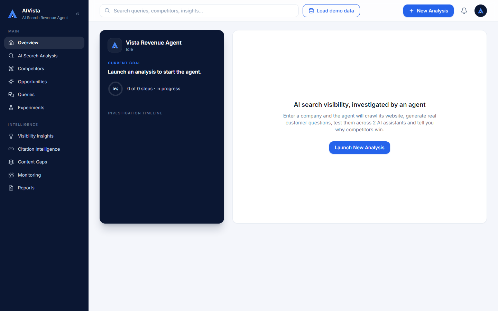 | **New Analysis**: company details in, 7 queries × 2 assistants out 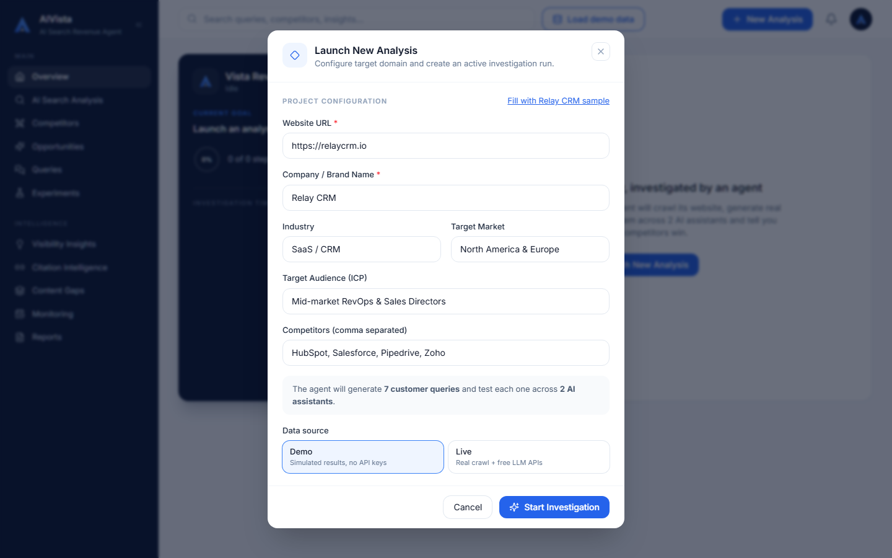 |
| **Agent running**: live investigation timeline 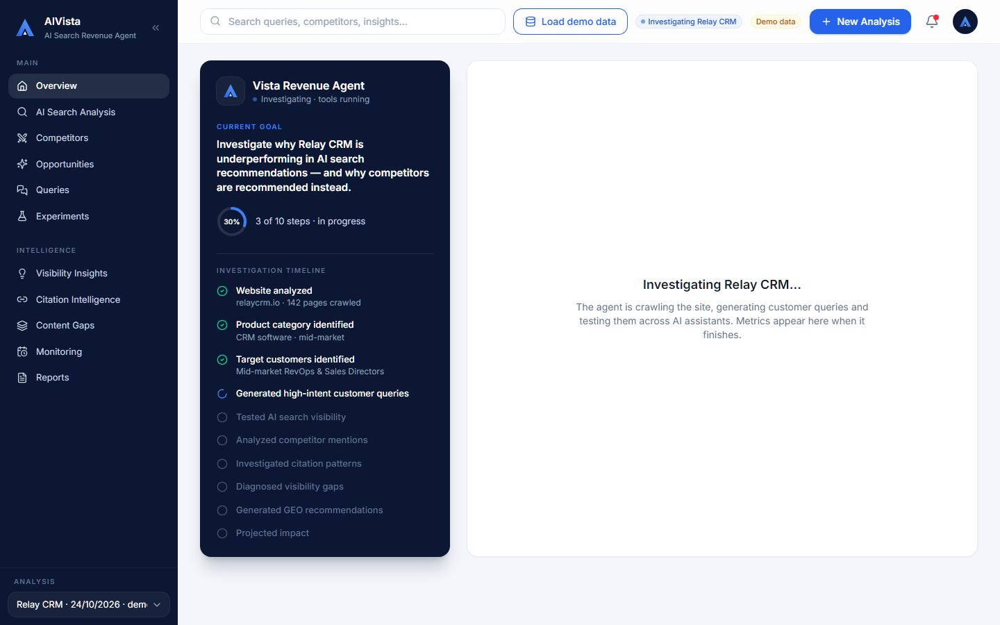 | **Overview**: KPIs, visibility trend and projected impact  |
| **AI Search Analysis**: findings with evidence, website profile, visibility per assistant 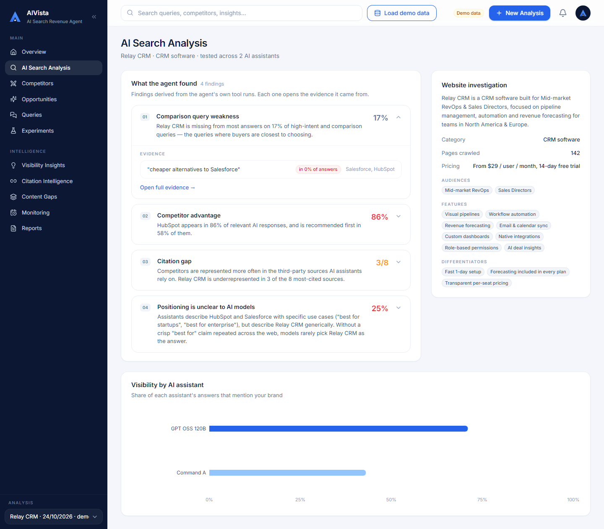 | **Competitors**: mention, citation and recommendation rates, head-to-head 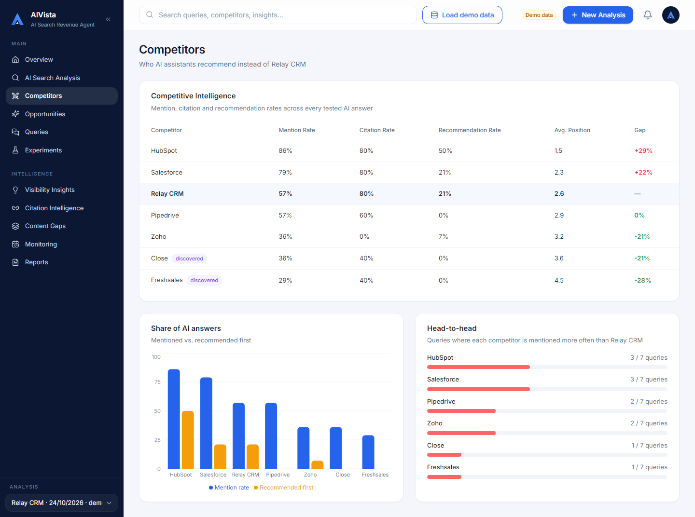 |
| **Opportunities**: GEO recommendations with actions and expected lift 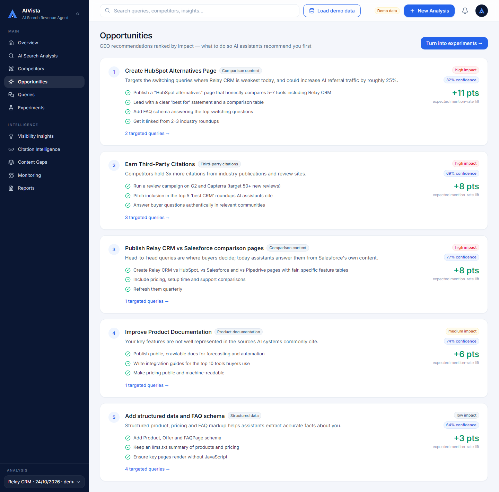 | **Queries**: every generated query and how the brand did 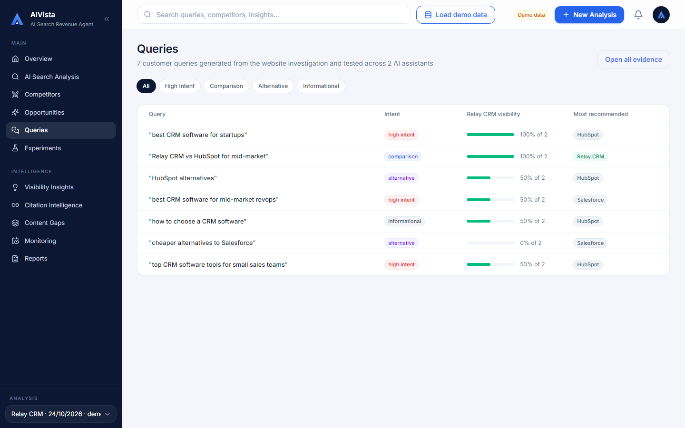 |
| **Evidence drawer**: the actual AI answers, brands and per-assistant result 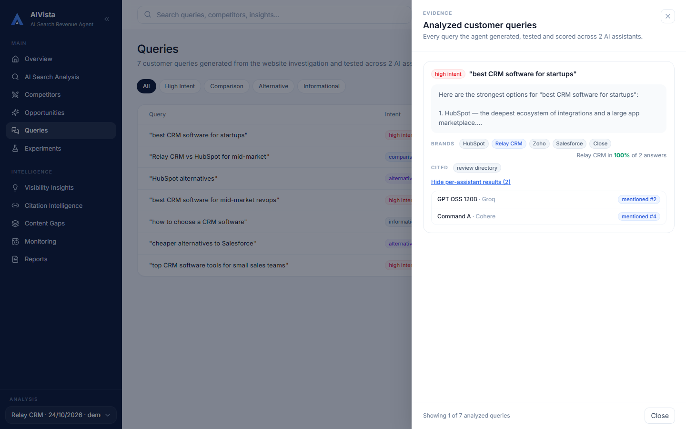 | **Experiments**: approve, start, complete; projected impact per experiment 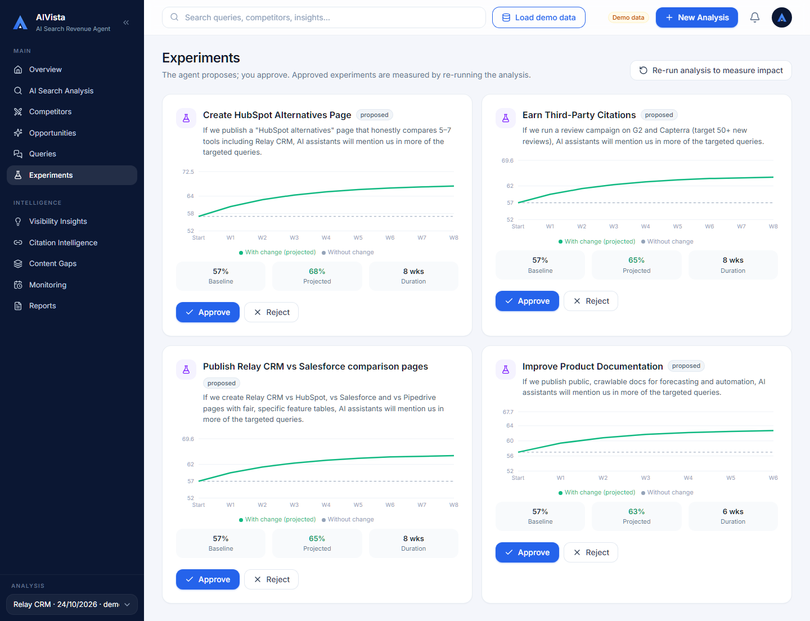 |
| **Visibility Insights**: by query intent and by provider 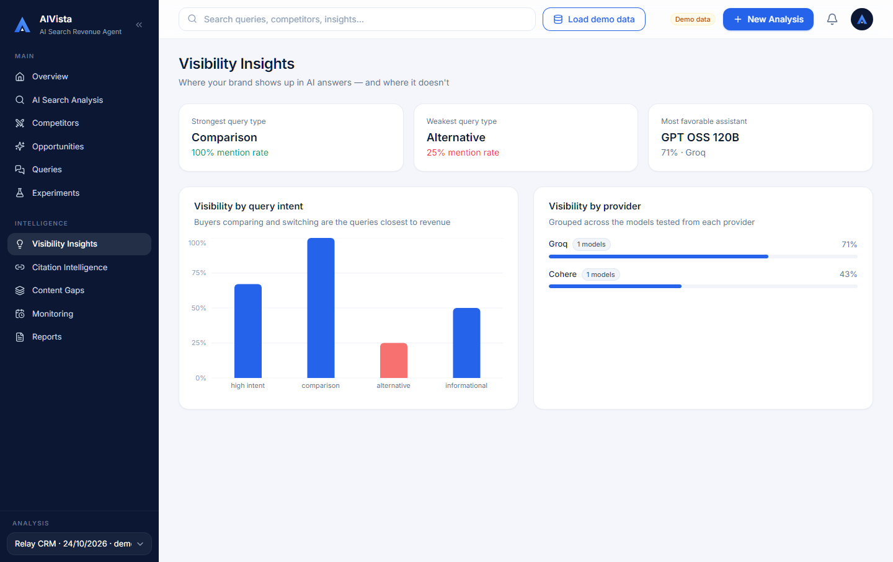 | **Citation Intelligence**: which sources AI answers rely on 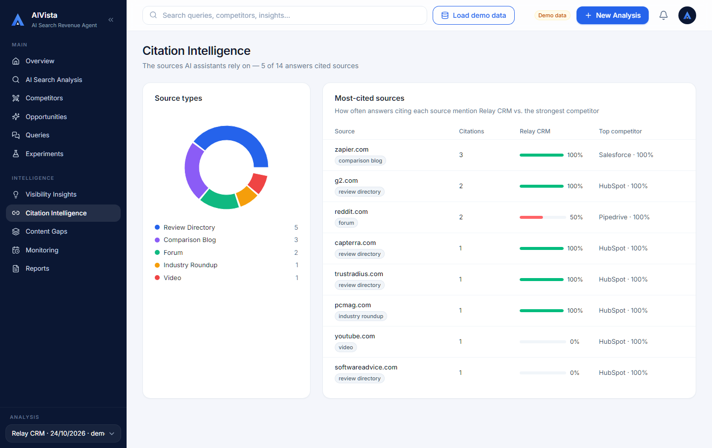 |
| **Content Gaps**: topics competitors cover and you don't 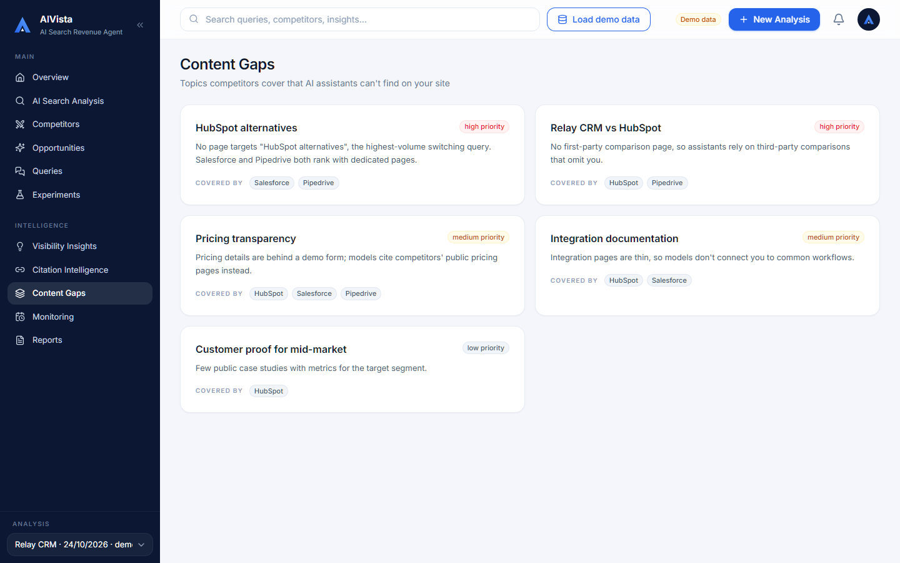 | **Monitoring**: scheduled re-runs build a real trend 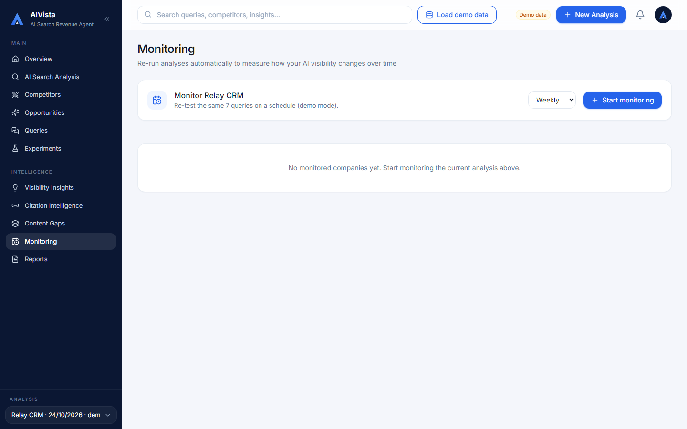 |

<details>
<summary>Full-length overview page</summary>

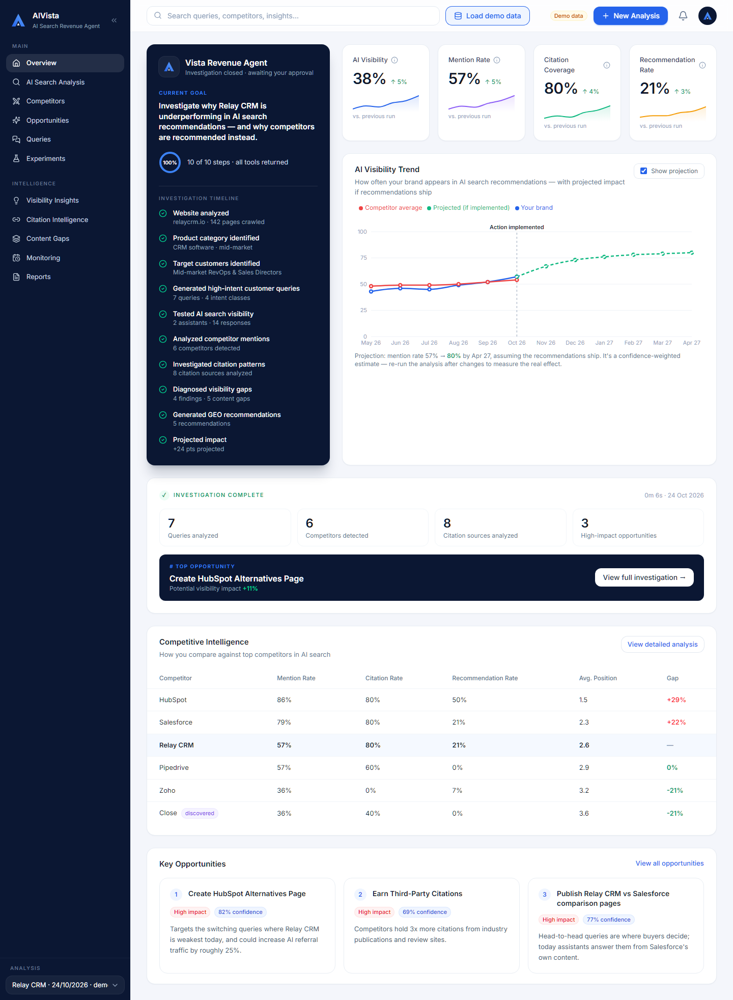

</details>

---

## Features

- **Agentic investigation pipeline**: crawl → understand → generate queries → test across AI assistants → analyze →
  diagnose → recommend → project impact.
- **Live progress**: 10-step investigation timeline streamed over SSE and saved as it runs, so a running analysis can be
  reopened from the sidebar at any time.
- **Dashboard**: AI Visibility, Mention Rate, Citation Coverage and Recommendation Rate KPIs with sparklines, plus a
  visibility trend with an "action implemented" marker and a projection line.
- **Evidence everywhere**: every finding links to the queries and the actual AI answers behind it.
- **Competitor discovery**: brands the assistants recommend that you didn't list are detected and added
  (duplicates like "Zoho" and "Zoho CRM" are merged).
- **Citation intelligence**: cited sources classified as review directory, comparison blog, forum, news, video, vendor docs…
- **Experiments with human approval**: proposed → approved → running → completed / rejected.
- **Monitoring**: daily, weekly or monthly re-runs of a company; each run adds a real data point to the trend.
- **Reports**: run history with CSV and JSON export.
- **Demo mode**: the **Load demo data** button (next to the search bar) opens a full simulated analysis of the
  fictional company *Relay CRM*. No API keys needed.
- **Resilient on free tiers**: per-provider rate limits, retries on 429/5xx, a 1-token availability check per model,
  Gemini model fallback, and runs that still complete if the final AI diagnosis fails.
- **Optional accounts**: set `REQUIRE_LOGIN=true` for email/password sign-in with a private workspace per account.

---

## AI models

AIVista uses **3 free LLMs, no credit card needed**: one **brain** and two **AI assistants under test**.

| Role | Provider | Default model | Made by | Free tier |
|---|---|---|---|---|
| 🧠 **Brain**: query generation, product understanding, competitor discovery, diagnosis, recommendations | Google Gemini | `gemini-3.5-flash` | Google | Free AI Studio key |
| 🤖 **Assistant 1** | Groq | `openai/gpt-oss-120b` (low reasoning effort) | OpenAI (open model) | Free key, high daily limits |
| 🤖 **Assistant 2** | Cohere | `command-a-03-2025` (via Cohere's OpenAI-compatible API) | Cohere | Free trial key |

**Per analysis:** about 4 Gemini calls + 7 queries × 2 assistants = **14 answers**.

**Resilience built in:**
- **Gemini fallback:** if the main model is overloaded (503), rate-limited (429), retired (404) or too slow, the brain
  automatically tries `gemini-3.6-flash` → `gemini-flash-latest` → `gemini-3.5-flash-lite` → `gemini-3.1-flash-lite`.
- **Model availability check:** before each run, every tester model gets a 1-token request; models the account can't
  use are skipped and the next available model from that provider is used.
- **Pin any model** with `<PROVIDER>_MODEL`, for example `GROQ_MODEL=qwen/qwen3.8-27b`.
- **Optional extra testers:** Cerebras, NVIDIA NIM and GitHub Models are already integrated. Add their keys and raise
  `TEST_MODEL_COUNT` to use them.

---

## How the metrics are computed

All numbers come from the raw AI answers, with the same code in demo and live mode (`server/pipeline/metrics.ts`).

| Metric | Definition |
|---|---|
| **Mention rate** | Share of answers that mention the brand at all |
| **Recommendation rate** | Share of answers that name the brand **first** among all brands |
| **AI visibility** | Weighted score per answer: named first = 1, in the top 3 = 0.6, mentioned anywhere = 0.35, absent = 0 |
| **Citation coverage** | Share of source-backed answers (with citations) that include the brand |
| **Average position** | Mean rank of the brand among brands mentioned in an answer |
| **Gap** | Competitor mention rate minus the brand's, in percentage points |
| **Projected impact** | Each recommendation's expected lift × its confidence, with diminishing returns for overlapping actions, ramped over ~6 months (`server/pipeline/impact.ts`) |

> Projections are estimates. Re-running the analysis after shipping a change (or using **Monitoring**) measures the real effect.

---

## Architecture

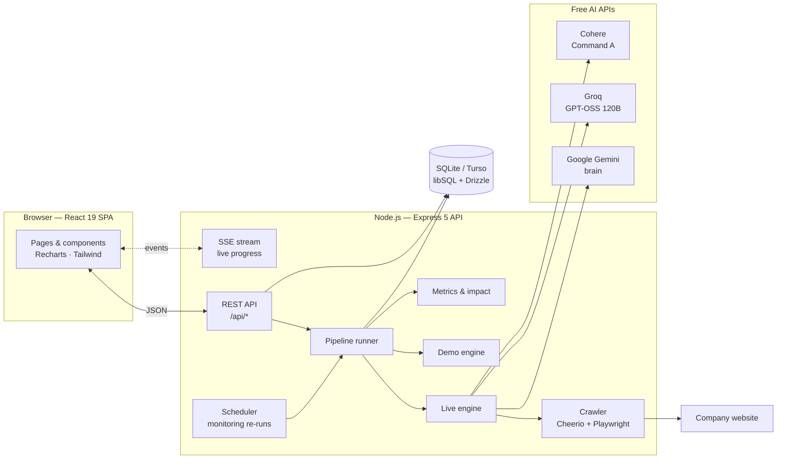

- **One process** serves both the built React app and the API in production.
- **Live and demo engines** implement the same interface (`server/pipeline/engine.ts`), so every metric, chart and
  page works identically in both modes.
- **Persistence:** analyses, every AI answer, experiments, schedules (and accounts when login is on) are stored in
  SQLite locally or in Turso (hosted libSQL) in production.

---

## Tech stack

| Layer | Technology | Version |
|---|---|---|
| **Language** | TypeScript (strict) | 5.8 |
| **Frontend framework** | React | 19 |
| **Build tool / dev server** | Vite | 7 |
| **Styling** | Tailwind CSS (via `@tailwindcss/vite`) | 4 |
| **Routing** | React Router | 7 |
| **Charts** | Recharts | 3 |
| **Icons / animation** | lucide-react · Motion | — · 12 |
| **Backend** | Node.js + Express | 22+ · 5 |
| **TypeScript runtime** | tsx (dev watch + production start) | 4 |
| **Live updates** | Server-Sent Events (native) | — |
| **Database** | SQLite via libSQL client, hosted on **Turso** in production | 0.15 |
| **ORM** | Drizzle ORM | 0.44 |
| **Crawling** | fetch + Cheerio; Playwright (headless Chromium) fallback for JS-rendered pages | 1.2 · 1.55 |
| **AI** | Google Gemini API, Groq API, Cohere API (OpenAI-compatible) | — |
| **Auth (optional)** | scrypt password hashing, SHA-256-hashed session tokens, httpOnly cookies, login rate limiting | — |
| **Scheduling** | In-process scheduler (checks every minute) | — |
| **Hosting** | Render (free web service) + Turso (free database) + UptimeRobot (keep-alive) | — |
| **Alternative hosting** | Oracle Cloud Always Free (Caddy + systemd scripts), Docker | — |

---

## Project structure

```
aivista/
├── shared/
│   └── types.ts                 # Types shared by the API and the React app
├── server/
│   ├── index.ts                 # Express app: REST API, SSE, static UI in production
│   ├── auth.ts                  # Optional accounts, sessions, workspaces
│   ├── scheduler.ts             # Monitoring schedules (daily / weekly / monthly re-runs)
│   ├── events.ts                # In-memory event bus for SSE
│   ├── db/
│   │   ├── schema.ts            # Drizzle schema + bootstrap SQL
│   │   └── client.ts            # libSQL client (SQLite file or Turso)
│   ├── pipeline/
│   │   ├── engine.ts            # Contract shared by the live and demo engines
│   │   ├── runner.ts            # Orchestrates a run, persists results, emits progress
│   │   ├── live.ts              # Live engine: crawl → Gemini → AI assistants → Gemini diagnosis
│   │   ├── demo.ts              # Demo engine: deterministic simulated answers (Relay CRM)
│   │   ├── crawl.ts             # Website crawler with Playwright fallback
│   │   ├── metrics.ts           # Mentions, citations, competitor stats, rule-based findings
│   │   └── impact.ts            # KPIs, trend, projections, experiments
│   └── providers/
│       ├── gemini.ts            # Gemini client with model fallback
│       ├── registry.ts          # AI assistant providers, model selection, availability checks
│       └── limiter.ts           # Rate limiter, retries, HTTP helpers
├── src/                         # React app
│   ├── main.tsx                 # Routes
│   ├── state.tsx                # App state: analyses, live progress, demo loader
│   ├── api.ts                   # Typed API client
│   ├── auth.tsx                 # Sign-in gate (only when REQUIRE_LOGIN=true)
│   ├── components/              # Layout, charts, agent panel, modal, evidence drawer…
│   └── pages/                   # Overview, Analysis, Competitors, Opportunities, Queries,
│                                #   Experiments, Insights, Citations, ContentGaps, Monitoring, Reports
├── deploy/
│   ├── RENDER.md                # Render + Turso guide (no card)
│   ├── ORACLE.md                # Oracle Cloud Always Free guide
│   ├── oracle-setup.sh          # One-time server setup (Node, Chromium, Caddy, systemd)
│   └── update.sh                # Pull, rebuild, restart (with DB backup)
├── scripts/
│   └── screenshots.mts          # Regenerates docs/screenshots with Playwright
├── docs/screenshots/            # README images
├── render.yaml                  # Render Blueprint
├── Dockerfile                   # Container image (includes Chromium)
└── .env.example                 # All settings, documented
```

---

## Getting started

**Requirements:** Node.js 22 or newer.

```bash
git clone https://github.com/roomslabdesigns-collab/aivista-v2.git
```
```bash
cd aivista-v2
```
```bash
npm install
```
```bash
npm run dev
```

Open **http://localhost:5173**. The app starts empty: click **Load demo data** to explore a full analysis with no keys,
or add API keys for live mode:

1. Copy `.env.example` to `.env`.
2. Add `GEMINI_API_KEY`, `GROQ_API_KEY` and `COHERE_API_KEY` (links in the [AI models](#ai-models) table).
3. Restart `npm run dev`, click **New Analysis**, choose **Live**.

Optional, for crawling JavaScript-heavy websites:

```bash
npx playwright install chromium
```

---

## Environment variables

| Variable | Default | Purpose |
|---|---|---|
| `GEMINI_API_KEY` | — | Brain LLM. Required for live mode |
| `GEMINI_MODEL` | `gemini-3.5-flash` | Main brain model (fallbacks are automatic) |
| `GROQ_API_KEY` | — | Assistant 1 |
| `COHERE_API_KEY` | — | Assistant 2 |
| `QUERY_COUNT` | `7` | Customer queries generated per analysis |
| `TEST_MODEL_COUNT` | `2` | AI assistants each query is tested against |
| `GROQ_MODEL`, `COHERE_MODEL`, … | — | Pin a specific model for a provider |
| `GEMINI_GROUNDED_TESTING` | `false` | Also test with Gemini + Google Search (returns real citations) |
| `CEREBRAS_API_KEY`, `NVIDIA_API_KEY`, `GITHUB_MODELS_TOKEN` | — | Optional extra assistants |
| `DATABASE_URL` | `file:data/aivista.db` | SQLite file, or `libsql://…turso.io` for Turso |
| `DATABASE_AUTH_TOKEN` | — | Turso token |
| `CRAWL_MAX_PAGES` | `20` | Pages crawled per website |
| `CRAWL_JS_FALLBACK` | `true` | Render JS-heavy pages with Playwright when installed |
| `REQUIRE_LOGIN` | `false` | `true` = email/password accounts with private workspaces |
| `ALLOW_SIGNUP` | `true` | With login on: set `false` after creating your accounts |
| `API_PORT` / `PORT` | `3001` | API port in dev / production |

---

## API reference

All endpoints are JSON under `/api`.

| Method | Endpoint | Description |
|---|---|---|
| `GET` | `/api/config` | Live-mode readiness, configured providers, query and assistant counts |
| `GET` | `/api/sample` | The Relay CRM demo input |
| `GET` | `/api/analyses` | List analyses (newest first) |
| `POST` | `/api/analyses` | Start an analysis: `{ input: CompanyInput, mode: "live" \| "demo" }` |
| `GET` | `/api/analyses/:id` | Analysis detail: steps, full report, all AI answers, experiments |
| `GET` | `/api/analyses/:id/events` | **SSE** stream of step progress until the run finishes |
| `DELETE` | `/api/analyses/:id` | Delete an analysis and its data |
| `PATCH` | `/api/experiments/:id` | Change status: proposed / approved / running / completed / rejected |
| `GET` | `/api/schedules` | Monitoring schedules with their measured history |
| `POST` | `/api/schedules` | Create a schedule: `{ input, mode, frequency }` |
| `PATCH` | `/api/schedules/:id` | Pause/resume or change frequency |
| `POST` | `/api/schedules/:id/run` | Run a schedule now |
| `DELETE` | `/api/schedules/:id` | Delete a schedule |
| `POST` | `/api/auth/signup` · `/login` · `/logout`, `GET /api/auth/me` | Accounts (only when `REQUIRE_LOGIN=true`) |

---

## Data model

| Table | Holds |
|---|---|
| `analyses` | One row per run: input, mode, status, step progress, the full report (JSON) |
| `responses` | Every AI answer: query, model, provider, text, detected mentions, citations, latency, error |
| `experiments` | Proposed experiments and their approval status |
| `schedules` | Monitoring schedules: company input, frequency, next run, last run |
| `workspaces`, `users`, `sessions` | Accounts (used only when login is on; otherwise one shared workspace) |

Tables are created and migrated automatically on startup (`server/db/client.ts`).

---

## Deployment

### Current setup: Render (free) + Turso (free), no card needed

- **App:** Render free web service built from `render.yaml` (native Node runtime). Every push to `main` redeploys.
- **Database:** Turso free libSQL database (`DATABASE_URL` + `DATABASE_AUTH_TOKEN`), so data survives restarts.
- **Keep-alive:** an UptimeRobot monitor pings `/api/config` every 5 minutes so the free service doesn't sleep.
- **Note:** Chromium doesn't fit in Render's 512 MB, so JS-only pages are crawled without it (`CRAWL_JS_FALLBACK=false`).

Step-by-step guide: [deploy/RENDER.md](deploy/RENDER.md)

### Alternative: Oracle Cloud Always Free

Always on, enough memory for Chromium, SQLite on disk. `deploy/oracle-setup.sh` installs Node.js 22, Chromium and Caddy
(automatic HTTPS), builds the app and runs it as a systemd service; `deploy/update.sh` deploys new commits with a database
backup. Guide: [deploy/ORACLE.md](deploy/ORACLE.md)

### Any Docker host

```bash
docker build -t aivista .
```
```bash
docker run -p 3001:3001 -v aivista-data:/app/data --env-file .env aivista
```

---

## Scripts

| Command | What it does |
|---|---|
| `npm run dev` | API on port 3001 + UI on port 5173, with hot reload |
| `npm run build` | Production build of the UI into `dist/` |
| `npm start` | Production server: UI + API from one process |
| `npm run lint` | TypeScript type-check |
| `npm run screenshots` | Regenerates the README screenshots (dev server must be running on an empty database) |

---

## Limitations and roadmap

**Current limitations**
- Free-tier AI APIs are slow at times: a live analysis takes about 4–15 minutes, mostly waiting on Cohere's trial key
  and Gemini when Google's servers are busy.
- Most free models answer from training data and don't cite live web sources, so citation data is thinner in live mode.
  `GEMINI_GROUNDED_TESTING=true` adds an assistant with real Google Search citations.
- With login off, anyone who has the link can use the app and see all analyses.
- Projections are estimates; real impact comes from Monitoring re-runs over weeks.

**Roadmap ideas**
- Paid-model option (GPT, Claude, Perplexity) for answers closer to what real users see.
- Email or Slack alerts when visibility changes after a monitoring run.
- PDF report export.
- Per-competitor deep dives and share-of-voice trends.
